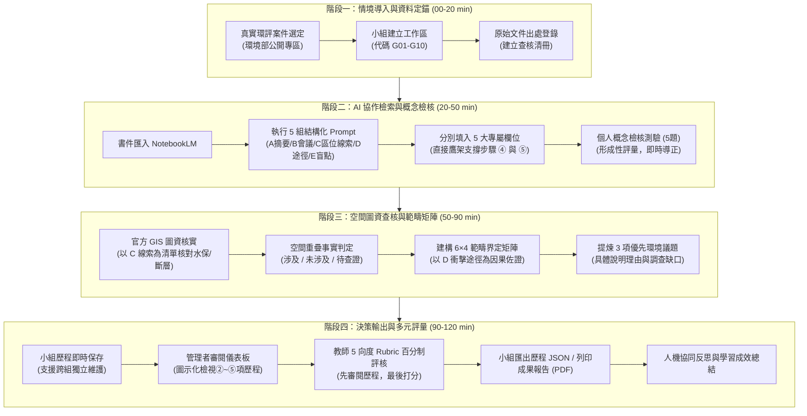

# 輔英科技大學 環境工程與科學系
## 《環境影響評估實作教學系統（Fooyin EIA Learning Lab）》課程設計綱要與教學藍圖

---

### 一、 課程基本資訊（Course Profile）

| 項目 | 內容說明 |
| :--- | :--- |
| **開課單位** | 輔英科技大學 環境工程與科學系（四技日間部） |
| **課程名稱** | 環境影響評估實作（Environmental Impact Assessment Practice） |
| **教學主題** | NotebookLM 智能檢索 × 官方圖資求真 × 範疇界定矩陣 × 多元學習診斷 |
| **授課對象** | 大三／大四 環工專業學生（已具備基礎環境法規與污染防制先備知識） |
| **教學時數** | 120 分鐘（連續 2 節課之微型實作專題） |
| **教學平台** | Fooyin EIA Learning Lab 前端互動實作系統（搭配 Google NotebookLM、環境部環評書件專區與官方空間圖資） |

---

### 二、 核心教學理念與痛點對策（Rationale & Pedagogy）

本課程旨在解決環境工程實務教學中面臨的**兩大教學痛點**，並建立**人機協作時代的工程求真精神**：

```
傳統教學痛點：環評書件動輒上千頁，學生難以迅速提煉關鍵工程行為與環境議題
　　↓ 解方：引進 Google NotebookLM 進行結構化提問與書件長文精準檢索
新興技術痛點：生成式 AI 容易產生「假想論點與幻覺（Hallucination）」，缺乏法律效力
　　↓ 解方：強制要求比對環境部與內政部「官方空間圖資」，落實求真查證
　　↓ 整合：將非結構化知識轉化為「6×4 範疇評估矩陣」，培養系統化環境決策思維
```

#### 四大支柱（Core Pillars）：
1. **🤖 人機協作（Human-AI Teaming）**：透過結構化提示詞（Prompts）引導 NotebookLM 提煉工程活動與公聽會審查意見，破除長篇專業書件閱讀阻力。
2. **🔎 官方求真（Grounding & Verification）**：建立「AI 推論 ≠ 法定事實」之批判意識，以政府官方 GIS 與法規公告作為唯一的敏感區位認定標準。
3. **📊 矩陣決策（Scoping Matrix）**：將抽象文字結構化為「6 大環境因子 × 4 項工程行為」二維矩陣，界定關鍵評估範疇。
4. **📈 即時診斷（Continuous Assessment）**：以步驟③的 5 題觀念檢核進行形成性診斷，搭配步驟⑥的 100 分向度規準（Rubrics）落實總結性評量。

---

### 三、 系統化教學架構流程圖（System Architecture）



---

### 四、 120 分鐘時間配當與模組詳細規劃（Lesson Plan）

| 時間區段 | 教學模組 | 學生實作任務 | 教師引導與鷹架支援 | 核心產出物 |
| :--- | :--- | :--- | :--- | :--- |
| **00 – 20 min**<br>(20 分鐘) | **模組 ①<br>資料匯入與情境定錨** | 1. 登記或切換小組代碼 (G01~G10)<br>2. 閱讀指定環評案件公開書件<br>3. 將資料管道與頁碼登錄至系統（即時自動存檔） | 1. 說明案例背景與工程邊界<br>2. 指導官方公開資料獲取管道<br>3. 提醒「每筆資料均需附出處」，並解說多組別保留機制 | 小組工作區、案件備註、文件出處清冊 |
| **20 – 50 min**<br>(30 分鐘) | **模組 ② & ③<br>AI 檢索與概念檢核** | 1. 依序執行 5 組 Prompt 並貼入 5 大專屬欄位（**各題填入字數均以 800 字為限**）：<br>　・A 開發概要（上限 800 字）➔ 拆解具體工程活動與規模<br>　・B 會議追蹤（上限 800 字）➔ 分辨專案小組審查會與公聽會意見與承諾<br>　・C 區位線索（上限 800 字）➔ 提煉敏感區位待查清單供步驟 ④ 官方圖資比對<br>　・D 衝擊途徑（上限 800 字）➔ 分析工程對環境因子之因果關係供步驟 ⑤ 矩陣判定<br>　・**E 盲點反思（上限 800 字）➔ 批判「AI 曾提出哪些尚未證實的結論？（標註資料盲點，防範模型幻覺）」**<br>2. 獨立完成 5 題觀念檢核測驗（形成性評量，即時診斷） | 1. 說明 5 組 Prompt 與對應欄位之鷹架關聯<br>2. 示範如何辨識 AI 生成之推測句與幻覺盲點<br>3. 解釋「專案小組審查會」與「民眾說明會」法律效力差異<br>4. 巡視個別檢核測驗答對率與歷程狀態 | 5 大主題式書件摘要紀錄（各限 800 字內）、AI 盲點與未證實結論清單、5 題形成性測驗得分 |
| **50 – 90 min**<br>(40 分鐘) | **模組 ④ & ⑤<br>空間查核與範疇矩陣** | 1. 連線至環境敏感區位、斷層與水質保護區圖資系統，以 Prompt C 提煉之線索進行地號核對<br>2. 自訂 4 項工程行為，參考 Prompt D 衝擊途徑填寫 6×4 範疇矩陣<br>3. 歸納 3 項優先環境議題與調查方案 | 1. 說明「活動斷層線」與「地質敏感區」之法規差異<br>2. 強調 ●（優先）與 △（待查）之工程研判邏輯<br>3. 輔導各組以 Prompt D 成果檢驗矩陣因果關聯 | 4 大敏感區位查核表、6×4 範疇矩陣、3 項優先議題論述 |
| **90 – 120 min**<br>(30 分鐘) | **模組 ⑥<br>成果輸出與多維評量** | 1. 整合全案資料並即時預覽報告<br>2. 接受教師透過圖示化儀表板審閱歷程與評審<br>3. 匯出小組歷程 JSON、下載 Word 報告 (.doc) 與列印成果 PDF（**Word 與 PDF 中五項提問內容均嚴格以 800 字為限並標註字數**）<br>4. 小組進行課後心得與工程倫理反思 | 1. **先檢視各組第 ② 至 ⑤ 項圖示化成果看板**<br>2. 執行五大向度百分制評分並填寫評語<br>3. 總結人機協同在未來環工實務之核心角色 | 小組 JSON 歷程檔、EIA 前置報告 Word/PDF、教師 100 分成績單 |

---

### 五、 Bloom 認知領域階層與教學目標對照（Bloom's Taxonomy）

| Bloom 認知層級 | 具體教學目標（學生在課程結束後能夠…） | 實作活動對應 | 評量工具與證據 |
| :--- | :--- | :--- | :--- |
| **記憶 (Remember)** | 說出環評法規主要流程，並能指出 4 類敏感區位（水保、斷層、保育、受體）之主管機關與公開圖資名稱。 | 步驟 ① 資料匯入<br>步驟 ③ 測驗第 1、4 題 | 資料來源清冊正確度、測驗得分 |
| **理解 (Understand)** | 闡述初步範疇矩陣符號（● 優先、△ 待查證、— 暫無證據）之工程定義，能清楚分辨「AI 生成推論」與「法定查核事實」。 | 步驟 ③ 測驗第 2、3 題<br>步驟 ② AI 盲點摘要 | 概念檢核作答結果、未證實結論說明完整度 |
| **應用 (Apply)** | 熟練運用 NotebookLM 提煉工程活動，並能親自操作政府空間圖資平台（eland、fault）完成地號空間套疊。 | 步驟 ② Prompt 執行<br>步驟 ④ 空間圖資查核 | 開發概要摘要完整性、4 類敏感區位官方佐證依據 |
| **分析 (Analyze)** | 將工程全生命週期行為（土方、興建、營運）與 6 大環境因子進行矩陣交叉分析，辨識因果關係與潛在受體。 | 步驟 ⑤ 範疇矩陣分析<br>步驟 ③ 測驗第 5 題 | 6×4 動態矩陣完整性、各因子判定合理性 |
| **評鑑 (Evaluate)** | 批判性審視生成式 AI 輸出之真實性與侷限性，評估既有書件之資料充分度，客觀指出欠缺之監測數據。 | 步驟 ② 盲點欄位<br>步驟 ⑤ 優先議題提煉 | AI 曾提出但未證實之結論清單、待調查資料規劃 |
| **創造 (Create)** | 統整多來源資料，產出一份兼具法規依據、圖資證據與工程分析邏輯之「EIA 範疇界定前置評估報告」。 | 步驟 ⑥ 綜合報告預覽<br>JSON / PDF 輸出 | 小組 EIA 正式成果報告、Rubric 百分制總分 |

---

### 六、 IEET 工程及科技教育認證核心能力對應（IEET Alignment）

| IEET 核心能力指標 | 課程教學對應點 | 達成成效之檢核依據 |
| :--- | :--- | :--- |
| **指標一：應用數學、科學及環境工程知識解決問題之能力** | 學生能依據環境工程學理，分析各項工程行為對於空氣、水質、噪音與生態之交互作用途徑。 | 步驟 ⑤ 範疇評估矩陣各欄位判斷準確性。 |
| **指標二：掌握現代化科技工具與資訊系統之能力** | 學生能熟練駕馭生成式 AI（NotebookLM 提問）與國家級 GIS 圖資平台（敏感區位、斷層套疊）。 | 步驟 ② 提示詞成果、步驟 ④ 空間查詢依據。 |
| **指標三：辨識、分析與規劃複雜工程問題之能力** | 學生能在龐雜書件中過濾出 3 項最優先評估之核心環境議題，並規劃後續調查方案與數據缺口補充。 | 步驟 ⑤ 優先環境議題、篩選理由與調查規劃。 |
| **指標四：恪守工程倫理、求真求實與社會責任之態度** | 學生能認知 AI 之不可靠性，堅持以官方圖資作為唯一法定依據，並誠實標註缺漏數據，杜絕虛構造假。 | 步驟 ② AI 盲點記錄、步驟 ③ 測驗第 3 題作答。 |
| **指標五：專案整合、有效溝通與團隊合作之能力** | 小組分工合作、整合各步驟產出，並匯出標準化 JSON/PDF 技術成果報告。 | 步驟 ⑥ 報告格式完整度與小組協作產出。 |

---

### 七、 多元評量規準（Assessment Rubric）

課程採**「形成性診斷（20%）」＋「總結性評量（80%）」**之多維度評量機制：

#### 1. 形成性評量（Formative Diagnostic）：步驟 ③ 概念檢核（5 題，滿分 100 分）
- 每題 20 分，即時計算得分。
- 目的在於即時診斷學生對於「官方圖資法定性」、「矩陣符號非風險等級」、「AI 必須人工查核」、「斷層法規定義」與「數據缺漏標註」等觀念之掌握度，未達 80 分者教師可個別介入輔導。

#### 2. 總結性多元規準（Summative Rubric - 100 分滿分）：

| 評核向度 | 配分 | 優等 (85 – 100%) | 滿意 (70 – 84%) | 待加強 (< 70%) |
| :--- | :---: | :--- | :--- | :--- |
| **1. 書件摘要與客觀引用力** | 25% | 開發行為拆解完整，各項數據與會議意見均檢附章節、頁碼或官方出處，無主觀臆測。 | 具備主要工程摘要，多數有註記出處，但少數細節未標明頁碼。 | 摘要過於簡略，未附出處或大量照抄未經驗證之 AI 文字。 |
| **2. 官方敏感區位查核真實度** | 25% | 4 大類敏感區位均檢附官方圖資平台查詢日期、公告字號或精確座標依據，判定客觀嚴謹。 | 4 大類均有查核判定，但部分項目缺乏具體圖資系統名稱或佐證依據。 | 僅憑常理或直接採信 AI 臆測填寫，完全缺乏官方圖資平台查證佐證。 |
| **3. 範疇矩陣因果判定嚴謹性** | 30% | 6×4 矩陣完整無缺漏，符號（●、△、—）使用邏輯一致，且能充分反映該案件之工程特性。 | 矩陣完成度達 90% 以上，大部分判定合乎情理，僅少數項目判準略顯寬鬆。 | 矩陣多處空白，或判定標準前後矛盾，無法體現工程活動對環境因子的因果影響。 |
| **4. 優先議題與後續調查規劃** | 10% | 具體提出 3 項優先環境議題，篩選理由具說服力，並明確指認調查資料缺口與執行方向。 | 提出 2~3 項議題，理由尚稱合理，但後續調查規劃略顯籠統。 | 議題流於口號或空泛陳述，未結合案件實際工程背景與環境特性。 |
| **5. AI 查核能力與工程倫理反思** | 10% | 深刻反思 NotebookLM 產出盲點，於 800 字限額內精確標註 AI 曾提出哪些尚未證實的結論、資料盲點與潛在幻覺，展現高度求真精神與精準彙報素養。 | 能列舉 1~2 項 AI 生成之待查點，但文字略嫌鬆散或未深入分析模型潛在幻覺風險。 | 盲目照單全收 AI 產出，或內容嚴重超載無提煉重點，未進行任何交叉查證與批判性反思。 |

---

### 八、 系統管理者審閱機制與多組別歷程圖示化架構（Admin Visual Audit Architecture）

為因應教師／系統管理者在評分前全面掌握各組真實填寫歷程，系統特別規劃**「先審閱歷程圖示 ➔ 後落實客觀評量」**之雙層架構：

1. **各組資料即時自動保存機制（Multi-Group Auto-Save）**：
   - 學生於步驟 ① 填寫或切換小組（G01~G10 或自訂組別）時，所有輸入框、單選測驗、敏感區位下拉選單及範疇矩陣狀態均即時同步至本機獨立資料庫（`localStorage`）。
   - 切換組別時，目前小組之資料會被妥善封存，不會與其他組別相互覆蓋，確保課堂各組數據之完整性。

2. **第 ② 至 ⑤ 項資料之圖示化呈現（Visual Dashboard for Items ②–⑤）**：
   - **③ 理解測驗成效圖示**：以計分徽章（例：`80 / 100 分`）與 5 題診斷卡片展示，直觀標示「✅ 正確掌握」、「❌ 觀念偏差」或「⏳ 尚未作答」，並列出學生選擇與標準概念對照。
   - **④ 環境敏感區位查核看板**：4 大法定敏感區位採視覺化警示標籤（🔴 涉及 / 🟢 未涉及 / 🟡 待查證），並直接呈現檢索依據、地號與查詢日期。
   - **⑤ 範疇矩陣熱點圖（Scoping Heatmap）**：將 6×4 矩陣轉化為高對比彩色熱點圖（● 優先用紅色高亮、△ 待查證用琥珀黃、— 暫無證據用冷灰），同時統計各符號數量比例，並以卡片呈現 3 項優先環境議題。
   - **② NotebookLM 5 大結構化成果看板**：
     * A. 開發概要與工程活動卡（為步驟 ⑤ 範疇矩陣提供具體行為）
     * B. 審查會與公聽會意見追蹤卡（掌握公眾參與焦點與開發單位承諾）
     * C. 書件敏感區位線索卡（字數 ≤ 800 字，直接作為步驟 ④ 官方 GIS 核實之待查清單）
     * D. 環境衝擊途徑分析卡（字數 ≤ 800 字，直接作為步驟 ⑤ 範疇矩陣因果判定之理論依據）
     * **E. 人機批判與防範幻覺高亮警示框**（字數 ≤ 800 字，檢驗學生是否針對「AI 曾提出哪些尚未證實的結論？標註資料盲點，防範模型幻覺」進行深入反思）

3. **最後才進行教師評分（Review First, Grade Later）**：
   - 系統管理者於步驟 ⑥ 頂部切換組別或點選「📥 載入外部小組 JSON 審閱」後，畫面先展開上述完整的圖示化歷程看板。
   - 教師在充分掌握學生實質產出與人機反思深度後，於下方進行 5 向度 Rubric 百分制評分並填寫指導評語。
   - 點擊「💾 儲存評分與講評至此組歷程」後，成績與講評即刻寫入該組資料庫，並自動同步至 Word 報告、PDF 列印與 JSON 歷程檔中。

4. **五種提問 800 字字數上限與輸出報告規範（Strict 800-Character Limit & Multi-Format Exports）**：
   - **前端即時字數管控**：步驟 ② 中 5 大輸入欄位均設定 `maxlength="800"`，並配置即時動態計數徽章（`0 / 800 字`）。字數達到 700 字時轉為琥珀黃預警，達到 800 字時轉為紅色告警並鎖定輸入，訓練學生以簡明精準之工程專業用語彙報。
   - **資料庫截斷防護**：本機自動儲存模組（`collectCurrentFormData`）在寫入 `localStorage` 前執行二次切片防護（`.slice(0, 800)`），確保多組別歷史紀錄嚴格符合限額。
   - **Word 報告匯出（.doc 檔）**：支援一鍵產生完整排版之 Word 成果報告，五大題目的標題旁自動標註實際填答字數（如：`字數：348 / 800 字`），內文嚴格依 800 字上限輸出，並以高亮提示框突顯「E. AI 盲點與防範模型幻覺」。
   - **PDF 成果列印**：支援 `@media print` 專業列印樣式，自動隱藏無效的網頁控制列與導覽鈕，自動展開所有滾動卡片以防止文字截斷，並在頁首呈現標準報告抬頭，確保輸出之 PDF 報告完整呈現小組檢索歷程與教師評定成果。

---

### 九、 教學實施注意事項與環境配置（Teacher Guidelines）

1. **網路與帳號準備**：
   - 學生須具備 Google 帳號以登入 NotebookLM。
   - 建議教師提前將目標案件之環評說明書 PDF 檔案下載置於共享雲端，節省課堂下載時間。
2. **防範作弊與跨電腦批改（Import/Export JSON）**：
   - 本系統運作於純前端，學生在各自電腦操作並儲存。
   - 學生完成實作後，點選**「📦 匯出小組 JSON」**提交作業。
   - 教師在個人電腦開啟本系統，於步驟 ⑥ 點選**「📥 載入外部小組 JSON 審閱」**，即可在教師端重現該組之完整填寫歷程、圖示化看板並進行評分存檔，達成無伺服器環境下的高效率批閱作業。
3. **法規與安全提醒**：
   - 系統設定期限為 `2026/11/05 23:59`。此期限為教學示範用之瀏覽器端判斷，正式校務評量系統建議結合後端驗證身分與伺服器時間戳記。
